<!-- ═══════════════════════════  LAUNCH PAD  ═══════════════════════════ -->

<h3 align="center">
  &nbsp;<a href="https://mihiran.me">mihiran.me</a>
  &nbsp;&nbsp;·&nbsp;&nbsp;
  &nbsp;<a href="https://www.linkedin.com/in/mihiran-thilakarathna">LinkedIn</a>
  &nbsp;&nbsp;·&nbsp;&nbsp;
  &nbsp;<a href="mailto:thmthilakarathna@gmail.com">thmthilakarathna@gmail.com</a>
  &nbsp;&nbsp;·&nbsp;&nbsp;
  &nbsp;<a href="https://wa.me/94760453356">+94 76 045 3356</a>
</h3>

<!-- ═══════════════════════════  01 · ABOUT  ═══════════════════════════ -->

<!-- ═══════════════════════════  02 · STACK  ═══════════════════════════ -->

<!-- ═══════════════════════════  03 · JOURNEY  ═══════════════════════════ -->

<!-- ═══════════════════════════  04 · ACTIVITY  ═══════════════════════════ -->

<!-- Generated daily by .github/workflows/profile.yml straight from the GitHub API -->

<!-- ═══════════════════════════  05 · PET  ═══════════════════════════ -->

<!-- ═══════════════════════════  LIFTOFF  ═══════════════════════════ -->

