<!-- ═══════════════════════════  LAUNCH PAD  ═══════════════════════════ -->

  
  
  
  

<!-- ═══════════════════════════  01 · ABOUT  ═══════════════════════════ -->

<!-- ═══════════════════════════  02 · STACK  ═══════════════════════════ -->

<!-- ═══════════════════════════  03 · JOURNEY  ═══════════════════════════ -->

<!-- ═══════════════════════════  04 · ACTIVITY  ═══════════════════════════ -->

<!-- Generated daily by .github/workflows/profile.yml straight from the GitHub API -->

<!-- ═══════════════════════════  LIFTOFF  ═══════════════════════════ -->

  

